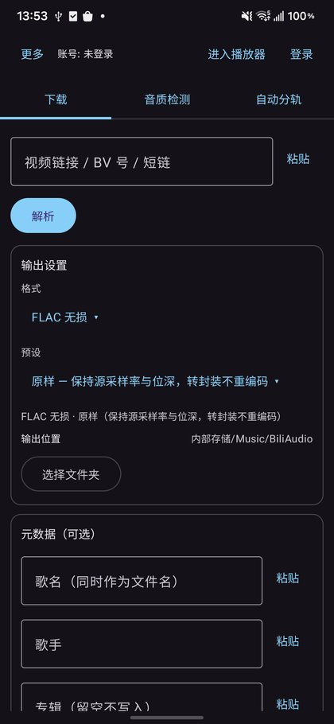
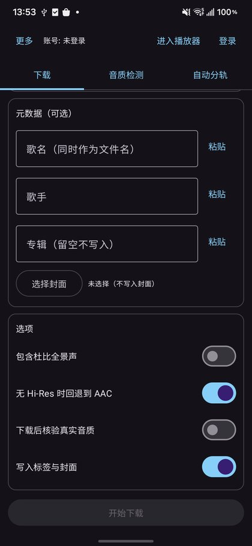
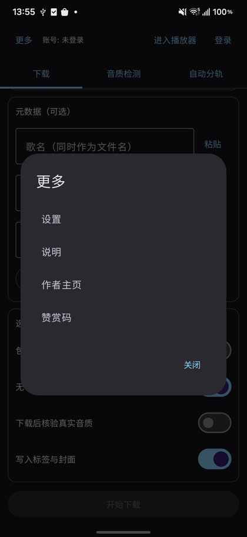
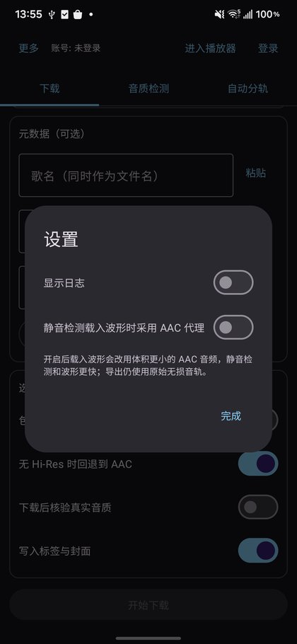
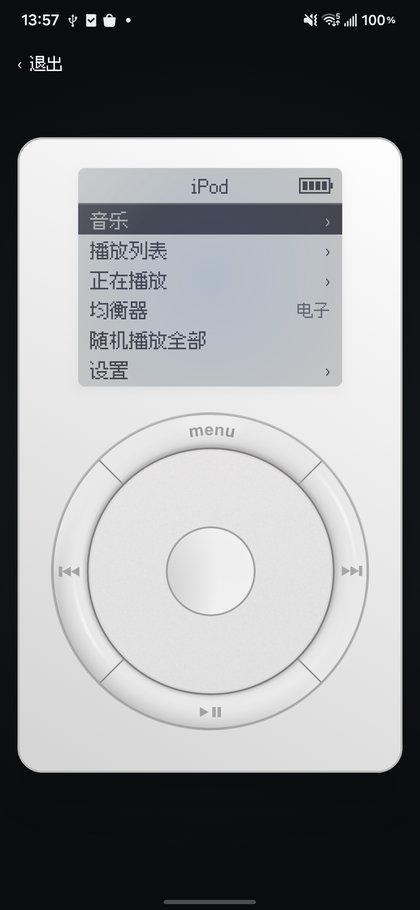
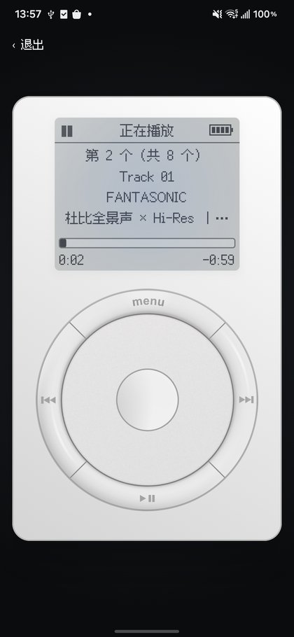
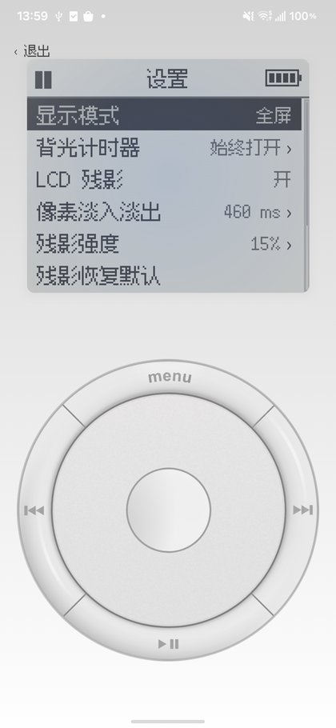

# B站无损音频（Android）

B 站 Hi-Res 无损音频下载器，桌面版 `bili_audio` 的安卓版本。功能对齐桌面端：
直连 B 站接口取流、核验真实音质、1–100 评分、多 P、整轨分轨、多格式导出。

当前版本：**1.18**

- 纯 Kotlin + Jetpack Compose
- ffmpeg 8.1 进程内运行（ffmpeg-kit），不依赖 yt-dlp / BBDown
- 支持大会员 Hi-Res FLAC（30251）与杜比全景声（30250）
- 内置 iPod 风格播放器：本地无损播放、8 段均衡器、睡眠定时、锁屏控制
- 所有处理在手机上离线完成，不上传任何音频

## 界面预览

| 下载 | 自定义元数据 | 更多 |
| --- | --- | --- |
|  |  |  |
| **设置** | **iPod 播放器** | **正在播放** |
|  |  |  |

| 全屏模式 |
| --- |
|  |

## 功能

### 下载
- 粘贴链接 / BV 号 / 短链，或从 B 站 App「分享」直接发到本应用；会自动从「标题 + 链接」的分享文本里只提取链接
- 自动挑选 Hi-Res FLAC，没有时回退最高 AAC，可选同时下杜比全景声
- 多 P 下载（`all` 或 `1,3-5`）
- 自定义元数据：歌名（同时作为文件名，默认视频标题）、歌手（默认 UP 主）、专辑（留空不写入）、封面（未选择则不写入）
- 4 线程分片 + 断点续传 + 流地址过期自动刷新
- 实时进度、MB/s、剩余时间，前台服务保证切后台继续跑

### 输出格式
| 格式 | 扩展名 | 说明 |
| --- | --- | --- |
| FLAC 无损 | `.flac` | 转封装不重编码 |
| iPod 专用 | `.m4a` | ALAC · 44.1kHz · 16bit · 立体声 · 高质量抖动 |
| ALAC | `.m4a` | 原样 / CD 兼容（44.1k 16bit） |
| WAV | `.wav` | 16bit/44.1k 或 24bit 原采样率 |
| MP3 | `.mp3` | LAME VBR V5 / V2 / V0 |
| AAC | `.m4a` | 128k / 192k / 256k |

### 音质核验
- 下载后自动解码 PCM，32k 点 FFT 计算有效带宽与截断陡峭度
- 结论：无损 / 带宽受限 / 升频 / 假无损 / 有损编码
- 独立「音质检测」页：对任意视频分段采样评分（1–100），也可以检测本地音频文件

### 自动分轨
- **默认时间列表（视频坐标）**：载入时只读视频标题和时长，不下载音频；导出时才下载完整音频
- **静音检测**：先点「载入波形」下载完整音频并解码，波形可视化，拖动红线调整分割点，点空白处新增
- 下载完整音频时显示进度、下载速度、预计剩余时间；同一视频会复用缓存，导出时不再重复下载
- **时间列表**：粘贴曲目表自动识别（支持「1. 歌名 0:00」「02 歌名 3:24」「Track 05 …」「00:00 歌名」等写法）
- 读取分段后可以逐首修改歌名；可勾选「将视频封面作为专辑封面」，未勾选且未选择封面时不写入封面
- 自定义歌手 / 专辑 / 封面，嵌入每个分轨
- 可选「AAC 代理」载入波形：只下载较小的 AAC 用于波形与静音检测，导出仍使用原始无损音轨
- 分轨可跟随源格式（FLAC 无损重编码、AAC 直接 copy），也可转成任意目标格式

## 播放器（iPod）

首页右上角「进入播放器」，左上角「‹ 退出」返回。主界面左上角「更多」里可以打开设置（显示日志、波形 AAC 代理）、说明、作者主页和赞赏码。

- **机身两种模式**：边框模式（深色背景 + iPod 外壳，和网页里的组件同尺寸）／全屏模式（整个手机就是 iPod）
- **滚轮操作**：实物纹理贴图 + 薄阴影；绕圈拖动滚动（每格震动）、外圈 MENU / ⏮ / ⏭ / ⏯ / 中间选择
- **曲库**：默认只显示 App 下载的音频（`Music/BiliAudio`）；「音乐 → 从手机添加」调用系统文件管理器选择手机文件夹，可添加多个，重启后保留，并可在「已添加文件夹」里查看或移除；添加的文件夹会合并进歌曲 / 专辑 / 歌手
- **页面动画**：顶部栏固定不动，只有内容区左右滑动；进入下级时旧页整页向左滑走、新页从右侧衔接，返回反向；线性动画，不再抽帧
- **正在播放**：曲目序号「第 N 个（共 M 个）」、歌名、歌手、专辑名；歌名过长时按像素屏抽帧滚动（约 8fps，一次移动 1 个字体像素）
- **原版布局**：顶部暂停键 / 正在播放 / 四格手机电量电池；1 像素分隔线；原版圆角进度条与左右时间
- **屏幕比例**：按参考图 525×867 机身、360×298 屏幕、434 滚轮重新排版，屏幕更靠近机身边框
- **屏幕外观**：LCD 四周是柔和外阴影，不再有深色边框
- **背光计时器**：关闭 / 1 秒 / 2 秒 / 3 秒 / 5 秒 / 始终打开；无操作到点后压暗屏幕，滚轮操作立即点亮
- **LCD 残影**：约 30fps 连续采样，白→黑和黑→白都会留下残影；默认开启、460ms、15%，可开关、调淡入淡出时间和强度，设置里可一键恢复残影默认值
- **右侧滚动条**：菜单超过 6 行时在右侧显示像素滚动条
- **竖屏锁定**：应用固定竖屏
- **8 段均衡器**：60 / 170 / 310 / 600 / 1k / 3k / 6k / 12k，±12 dB，内置 8 套预设，可保存自定义预设
- **睡眠定时**：15/30/45/60/90 分钟，到点自动暂停
- **后台播放**：Media3 MediaSessionService，锁屏 / 通知栏 / 蓝牙 / 耳机线控均可控制
- 像素字体：Fusion Pixel 12px（OFL-1.1，中文全覆盖）

> 说明：Android 系统混音器通常固定 48 kHz，44.1k 素材会被系统重采样；播放器显示的是「解码规格」，不是「输出规格」。想 bit-perfect 需要 USB DAC 独占模式，普通 App 无法做到。

## 系统要求

- Android 8.0（API 26）及以上
- **arm64-v8a**（64 位，不支持 32 位老机器）
- 安装包约 44 MB（内置 ffmpeg）

## 安装

```powershell
adb install -r app-release.apk
```

或把 APK 传到手机直接安装（需要允许「安装未知来源应用」）。

## 登录

点右上角「扫码登录」，三种方式任选：

1. **扫码**：用另一台设备上的 B 站 App 扫码
2. **网页登录**（推荐单机使用）：App 内打开 B 站登录页，手机号验证码 / 密码都能用，登录后点「完成登录」
3. **Cookie / cookies.txt**：粘贴 `SESSDATA=...` 或选择浏览器扩展导出的 `cookies.txt`

Cookie 保存在 `EncryptedSharedPreferences`（Android Keystore 加密）。

> Hi-Res 无损音轨需要大会员账号；未登录或非会员时自动回退到最高 AAC。

## 输出位置

默认写入系统媒体库：

```
内部存储/Music/BiliAudio/<专辑>/01 歌名.flac
```

- 单 P 视频直接放在 `Music/BiliAudio/`
- 多 P / 分轨会建 `<专辑>` 子目录
- 同名文件自动加 `(1)`、`(2)`
- 也可以在「输出设置」里用 SAF 选择任意文件夹（如 SD 卡）

下载或分轨完成后，弹窗可直接「打开文件」。

## 技术说明

| 组件 | 用途 |
| --- | --- |
| OkHttp | B 站 API、WBI 签名请求、分片下载、封面 |
| ffmpeg-kit 8.1（LGPL） | 转封装 / 转码 / 标签封面 / 解码 PCM |
| Media3 / ExoPlayer | 本地无损播放、MediaSession、后台播放 |
| ZXing | 登录二维码 |
| Jetpack Compose | 界面与波形绘制 |
| Fusion Pixel 12px（OFL） | iPod 屏像素字体（中文覆盖） |

- WBI 签名、音质评分、分轨算法与桌面版逐行对应（同样的 mixin 表、同样的 55 dB 动态阈值、同样的 1–100 评分公式）
- 本项目的 ffmpeg 构建**不含 TLS**，因此 App 内置了一个 127.0.0.1 的极简 HTTP 代理（支持 Range），
  ffmpeg 通过它读取远程音频；这样既保留远程采样能力，又不用把整首歌先下完
- 标签/封面统一用 ffmpeg 写入（`-c:a copy`），FLAC 写入标准 `TRACKNUMBER`/`TRACKTOTAL` 与 front cover

## 构建

需要 JDK 17+、Android SDK 36：

```powershell
# 安装官方 Android CLI（含 SDK 管理）
winget install --id Google.AndroidCLI --source winget
android sdk install platforms/android-36 build-tools/36.0.0 platform-tools

# 构建
.\gradlew.bat :app:assembleDebug

# 单元测试（FFT 带宽检测 / 曲目表解析）
.\gradlew.bat :app:testDebugUnitTest
```

签名：把 keystore 信息写进 `keystore.properties`（已被 `.gitignore` 排除）：

```properties
storeFile=keystore/bili-audio.jks
storePassword=******
keyAlias=biliaudio
keyPassword=******
```

然后 `.\gradlew.bat :app:assembleRelease`，产物在 `app/build/outputs/apk/release/app-release.apk`。

## 已知限制

- 番剧 / 影视（ep / ss）暂不支持，只处理普通投稿视频
- 充电专属视频需要已充电账号
- 只提供 arm64-v8a
- 分轨默认只读取视频时长；静音检测需要先「载入波形」下载完整音频，时间列表模式在导出时才下载一次

## 许可

- 应用自身：待定
- ffmpeg-kit / FFmpeg：LGPL-3.0（未使用 `-gpl` 变体）
